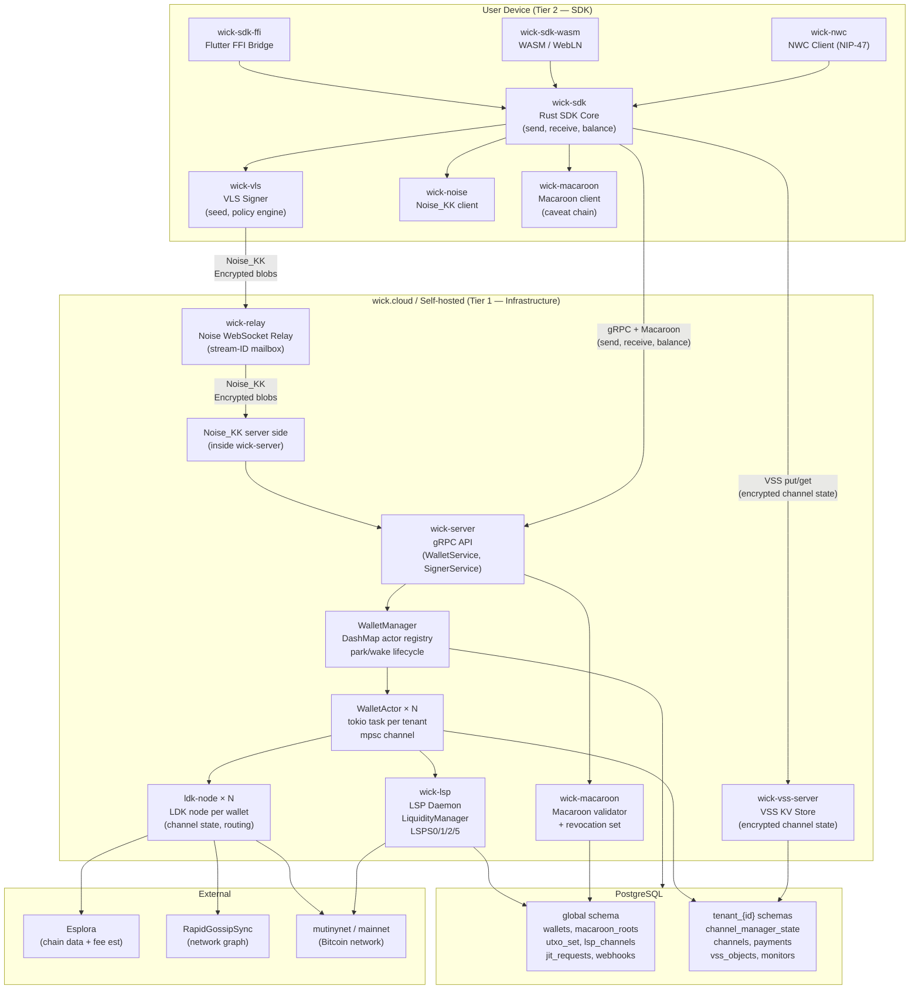

# Architecture Overview

Container-level diagram of the Wick platform as it exists today (May 2026), kept in sync with `docs/product-spec.md`.

## Container Responsibilities

| Container | Crate | Responsibility |
|-----------|-------|---------------|
| VLS Signer | `wick-vls` | Holds seed; policy engine validates every signing request |
| Rust SDK Core | `wick-sdk` | Orchestrates VLS, Noise tunnel, Macaroon auth, VSS transparently |
| Flutter FFI | `wick-sdk-ffi` | flutter_rust_bridge bindings to SDK core |
| WASM / WebLN | `wick-sdk-wasm` | wasm-pack module; WebLN provider interface |
| NWC Client | `wick-nwc` | NIP-47 Nostr Wallet Connect integration |
| Noise_KK (client) | `wick-noise` | Noise_KK handshake + session on device side |
| Macaroon (client) | `wick-macaroon` | HMAC chain construction, caveat attachment |
| Relay | `wick-relay` | Dumb-pipe WebSocket relay; routes blobs by stream ID |
| gRPC API | `wick-server` | External API; Macaroon interceptor; routes to WalletManager |
| WalletManager | `wick-server` | Actor registry (DashMap); park/wake lifecycle; memory budget |
| WalletActor | `wick-server` / `wick-lightning` | Tokio task; owns LdkNode exclusively; serialised via mpsc |
| LSP Daemon | `wick-lsp` | LSPS0/1/2/5 flows; LiquidityManager; SCID dispatch |
| VSS Server | `wick-vss-server` | Encrypted versioned KV storage for channel state |
| Macaroon (server) | `wick-macaroon` | HMAC chain validation; revocation set; spend-window enforcement |
| PostgreSQL | — | Global schema (server-wide) + per-tenant schemas (wallet state) |

## Diagrams disagree with architecture doc?

Any gap between this diagram and `docs/wick_architecture.md` should be treated as one of:
- **(a) bug** — code does not yet match the intended design
- **(b) deferred feature** — design intended but not yet implemented
- **(c) forgotten decision** — intent changed but architecture doc not updated

Flag divergences in `docs/invariants.md` or as an open question in the relevant feature spec.
