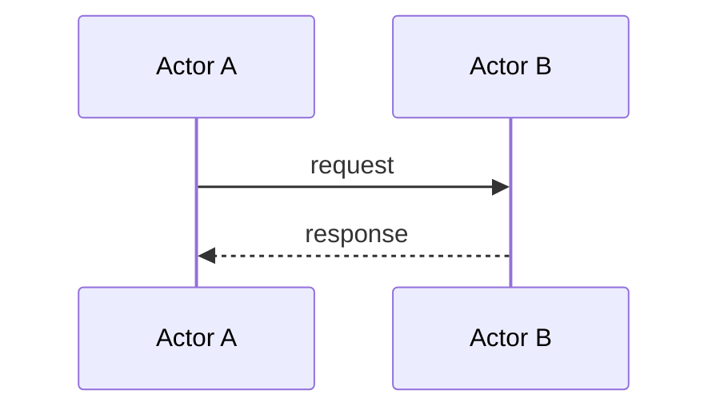

# Feature: <name>

**Status.** draft
**Phase.** PoC | Phase 1 | Phase N
**Owner.** <person>
**Last updated.** YYYY-MM-DD

## Summary

<One paragraph. What it does, who it's for, why it matters.>

## User-facing behaviour

<What does the feature look like from outside? API contract, CLI, gRPC surface. Be specific.>

## Acceptance criteria

- [ ] <testable criterion>
- [ ] <testable criterion>
- [ ] <testable criterion>

## Sequence diagram

> Include ONLY if: 3+ actors, async cross-boundary coordination, compliance-sensitive ordering, multi-step state transitions across 3+ services, or saga-style flows. Delete this section if none apply.

### Failure modes considered

- <partial failure path 1>
- <partial failure path 2>

## Component design

> Include when the feature's internal structure isn't obvious — new modules, data model changes, interface other code depends on. Delete if a competent engineer would build it the obvious way.
>
> For full-stack features: pin the wire-format contract first (field names, types, casing, who coerces Postgres NUMERIC columns).

<modules, data shapes, interfaces>

## Non-goals

<What this feature explicitly does not do.>

## Touches

Invariants this feature relies on or modifies:

- [INV-XXX-N] — <how this feature uses the invariant>

## Depends on

- [[other-feature]] — <what's needed>

External:
- <libraries, third-party services>

## Approach

<High-level technical approach. Not implementation details — that's the EPCC Plan phase.>

## Open questions

- <unresolved at spec time>

## Out of scope

<Adjacent code this feature won't touch, even though it might seem related.>
