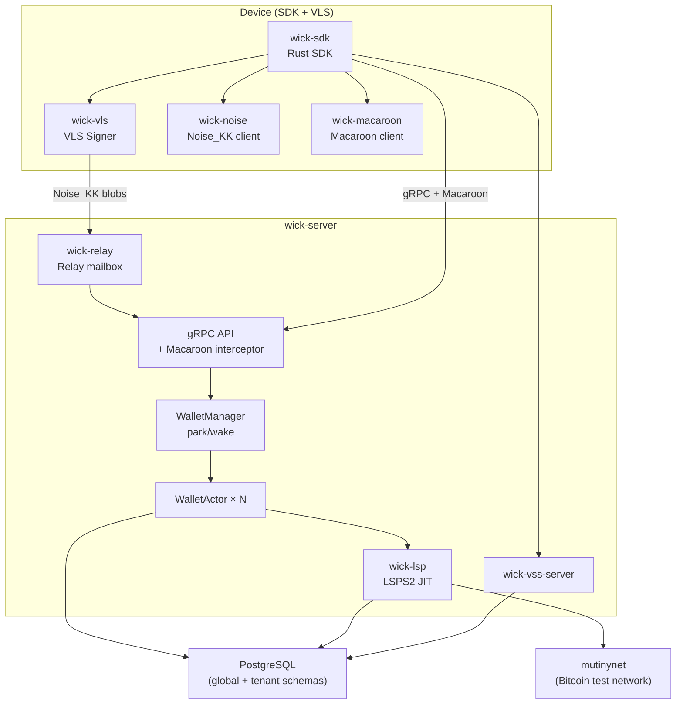

# Phase: PoC — Multi-tenant JIT on Mutinynet

**Status.** In progress
**Started.** ~March 2026
**Target completion.** June 2026 (estimated)

## Purpose

Prove the technical thesis end-to-end on a live test network:

1. A multi-tenant ldk-server can host multiple wallets in the same process with complete isolation.
2. LSPS2 JIT channels work — a wallet with zero balance receives a payment through a freshly opened JIT channel, fee deducted on delivery.
3. The VLS on-device signer enforces policy correctly — the server cannot move funds without device approval.
4. Park/wake lifecycle handles concurrent wakes under realistic load without OOM, deadlock, or HTLC loss.
5. Macaroon auth (revocation, spend-window, rotation) passes the automated test suite.

This is PoC, not Phase 0. It exists to validate technical and security assumptions. It does not need to be commercially deployable — it just needs to prove the thesis on mutinynet.

## Architecture Scope (this phase)

The diagram below shows what is in scope for the PoC. It is a strict subset of the full architecture overview in `docs/architecture-overview.md`.

**Out of scope for PoC:**
- Flutter FFI / WASM / NWC (SDK crates exist; not end-to-end validated)
- LSPS1 channel purchase
- LSPS5 webhooks
- Reorg reserve and griefing mitigation subsystems
- Reference Flutter wallet UI
- UTXO batching / CPFP / RBF subsystems
- WebLN browser extension

## In Scope

- [x] Noise_KK relay + VLS signer tunnel
- [x] Macaroon auth cascade (root → developer → user)
- [x] Macaroon revocation (nonce + LISTEN/NOTIFY)
- [x] Macaroon spend-window caveat enforcement
- [x] Server pubkey pinning (triple-source)
- [x] Multi-tenant WalletActor (actor model, mpsc, DashMap)
- [x] Park/wake lifecycle (activity poller, memory evictor, global semaphore, priority queue)
- [x] VSS server (encrypted versioned KV)
- [x] LSPS2 JIT channel open (LSP daemon, SCID dispatch, LiquidityManager)
- [ ] JIT payment round-trip on mutinynet — tenant-to-tenant — **in progress**
- [ ] Park/wake under concurrent mutinynet load — **in progress**
- [ ] CI integration test suite against mutinynet

## Done When

- [ ] `tenant_to_tenant_jit_payment_mutinynet` integration test passes reliably (≥5 consecutive runs)
- [ ] Park/wake test passes under simulated concurrent wake load on mutinynet
- [ ] VLS policy test: server-side manipulation attempt fails at VLS boundary
- [ ] Macaroon spend-window test: double-spend blocked
- [ ] All of the above run in a single `docker compose up` targeting mutinynet
- [ ] No `unwrap()` panics or deadlocks observed in 30-minute soak on mutinynet

## Active Work (as of May 2026)

Based on recent commits:
- Fixing EventQueue deadlock via PgKvStore future decoupling (`f53d3de`)
- JIT payment test fitting under `htlc_in_flight_percent` limit (`31fb1d1`)
- Multi-tenant LSP lifecycle stabilisation on mutinynet (`30befb7`)
- Diagnostic tracing for tenant-to-tenant JIT path (`33c4c60`)

## Phase 1 (after PoC)

Developer SDK beta — publicly accessible hosted instance at wick.cloud, Rust SDK on crates.io, developer macaroon issuance, basic dashboard. Gate on PoC "Done When" checklist above.
