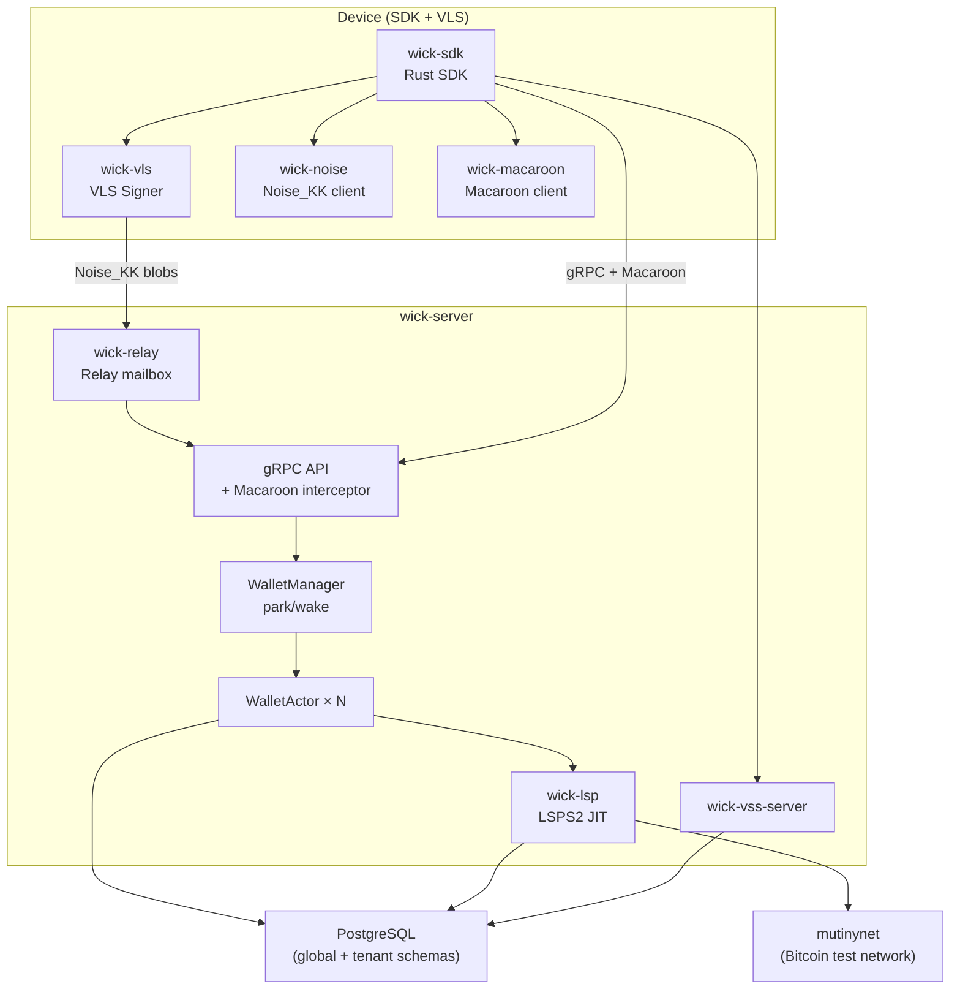

# Phase: PoC — Multi-tenant JIT on Mutinynet

**Status.** In progress
**Started.** ~March 2026
**Target completion.** June 2026 (estimated)

## Purpose

Prove the technical thesis end-to-end on a live test network:

1. A multi-tenant ldk-server can host multiple wallets in the same process with complete isolation.
2. LSPS2 JIT channels work — a wallet with zero balance receives a payment through a freshly opened JIT channel, fee deducted on delivery.
3. The VLS on-device signer enforces policy correctly — the server cannot move funds without device approval.
4. Park/wake lifecycle handles concurrent wakes under realistic load without OOM, deadlock, or HTLC loss.
5. Macaroon auth (revocation, spend-window, rotation) passes the automated test suite.

This is PoC, not Phase 0. It exists to validate technical and security assumptions. It does not need to be commercially deployable — it just needs to prove the thesis on mutinynet.

## Architecture Scope (this phase)

The diagram below shows what is in scope for the PoC. It is a strict subset of the full architecture overview in `docs/architecture-overview.md`.

**Out of scope for PoC:**
- Flutter FFI / WASM / NWC (SDK crates exist; not end-to-end validated)
- LSPS1 channel purchase
- LSPS5 webhooks
- Reorg reserve and griefing mitigation subsystems
- Reference Flutter wallet UI
- UTXO batching / CPFP / RBF subsystems
- WebLN browser extension

## In Scope

- [x] Noise_KK relay + VLS signer tunnel
- [x] Macaroon auth cascade (root → developer → user)
- [x] Macaroon revocation (nonce + LISTEN/NOTIFY)
- [x] Macaroon spend-window caveat enforcement
- [x] Server pubkey pinning (triple-source)
- [x] Multi-tenant WalletActor (actor model, mpsc, DashMap)
- [x] Park/wake lifecycle (activity poller, memory evictor, global semaphore, priority queue)
- [x] VSS server (encrypted versioned KV)
- [x] LSPS2 JIT channel open (LSP daemon, SCID dispatch, LiquidityManager)
- [ ] JIT payment round-trip on mutinynet — tenant-to-tenant — **in progress**
- [ ] Park/wake under concurrent mutinynet load — **in progress**
- [ ] CI integration test suite against mutinynet

## Done When

- [ ] `tenant_to_tenant_jit_payment_mutinynet` integration test passes reliably (≥5 consecutive runs)
- [x] Park/wake concurrent wake test: N concurrent `wake()` calls serialize correctly — exactly one factory call, all callers return Ok (`concurrent_wakes_serialize_via_cas` in manager.rs)
- [x] VLS policy test: policy rejection (status != 0x00) propagates as error, never treated as signature body (`policy_rejection_propagates_as_error_not_signature` in connection.rs)
- [x] Macaroon spend-window test: double-spend blocked (`second_spend_exceeding_limit_rejected` in spend_window_double_spend.rs)
- [x] Docker Compose for mutinynet: `deploy/docker/docker-compose.mutinynet.yml` + `Dockerfile`
- [ ] `tenant_to_tenant_jit_payment_mutinynet` passes reliably on the compose stack (≥5 consecutive runs)
- [ ] No `unwrap()` panics or deadlocks observed in 30-minute soak on the compose stack

## Known limitation — long-offline boot sync (root cause of the JIT hang)

**Symptom.** `tenant_to_tenant_jit_payment_mutinynet` appeared to "hang for 30 minutes" at `operator.register_lsp()` with no error.

**Root cause.** When a node (LSP or tenant) boots or wakes, it restores its LDK `ChannelManager` and channel monitors from Postgres, then calls `init::synchronize_listeners` (`wick-lightning/src/builder.rs`) to catch the persisted `best_block` up to the current chain tip. That catch-up is **linear in the number of blocks elapsed since the state was last persisted**, fetched batch-by-batch from Esplora. State left idle for days (mutinynet mines every ~30s ⇒ ~2,880 blocks/day) forces a walk of tens of thousands of blocks through a rate-limited public Esplora — tens of minutes. Because `register_lsp()` and the wake path had no client-visible deadline, this surfaced as a silent hang rather than an error.

Confirmed empirically (2026-05-30): a JIT channel from the 2026-05-22 runs left a monitor with `best_block` at block 3,121,137; the tip was 3,141,901 — a 20,764-block catch-up on every boot. The LSP tenant, Alice, and Bob all carried stale state derived deterministically from their constant mnemonics, so every run reproduced the same hang.

**Mitigations applied.**
- `OperatorClient::register_lsp()` now wraps the RPC in a 60s timeout (`REGISTER_LSP_TIMEOUT`) and returns `Error::Timeout` with a pointer to this section — a stuck boot is now an actionable error, not a hang.
- The server's `[park_wake].wake_deadline_secs` (90s) already bounds tenant wakes; a stale tenant fails its wake with `DeadlineExceeded` instead of hanging.

**Operational note.** This is primarily a stale-dev-state problem, not a production one: in normal park/wake, a tenant is offline for minutes, so the catch-up is a handful of blocks. Don't leave mutinynet test state idle for days. To recover a poisoned tenant, purge its `//manager` + `monitors//*` rows (and `channels` table) from its `tenant_<id>` schema so it boots fresh at the current tip. A durable fix (esplora script-based sync, or fast-forwarding `best_block` past a staleness threshold) is deferred to Phase 1 — see Done-When below.

## Open bug — JIT step-5 stall (next to fix)

With the stale-state hang resolved (above), a clean run on 2026-05-30 progressed through register_lsp (8.5s), connect_peer (1.8s), and Alice's on-chain channel open (confirmed in-block, usable at +213s), then **stalled at step 5 — `bob.lsps2_get_info()`** (the test produced no output past step 4).

Two server-side observations at that moment, to investigate next session:
- `wick_lsp: lsps2 channel_ready forward failed — No counterparty state for: 031ebe4d…` — this pubkey is **Alice** (tenant 14e6c970), whose *normal* (non-JIT) channel ChannelReady is being passed into the LSPS2 handler. Likely **benign/noisy** (the handler legitimately has no LSPS2 state for a non-buy peer) but `forward_channel_ready` in `wick-lsp/src/handler.rs` should skip non-JIT channels rather than log an error.
- The actual stall is `lsps2_get_info` / `receive_payment_jit` not returning. Suspect the LSP→client peer lifecycle (Bob idle ~3–4 min during Alice's channel-open wait) or the get_info path itself. This is a distinct issue from the boot-sync hang.

## Active Work (as of May 2026)

Based on recent commits:
- Fixing EventQueue deadlock via PgKvStore future decoupling (`f53d3de`)
- JIT payment test fitting under `htlc_in_flight_percent` limit (`31fb1d1`)
- Multi-tenant LSP lifecycle stabilisation on mutinynet (`30befb7`)
- Diagnostic tracing for tenant-to-tenant JIT path (`33c4c60`)
- **2026-05-30:** root-caused + fixed the 30-min register_lsp hang (stale `best_block` boot-sync crawl); added `REGISTER_LSP_TIMEOUT`. Next: JIT step-5 stall.

## Phase 1 (after PoC)

Developer SDK beta — publicly accessible hosted instance at wick.cloud, Rust SDK on crates.io, developer macaroon issuance, basic dashboard. Gate on PoC "Done When" checklist above.
