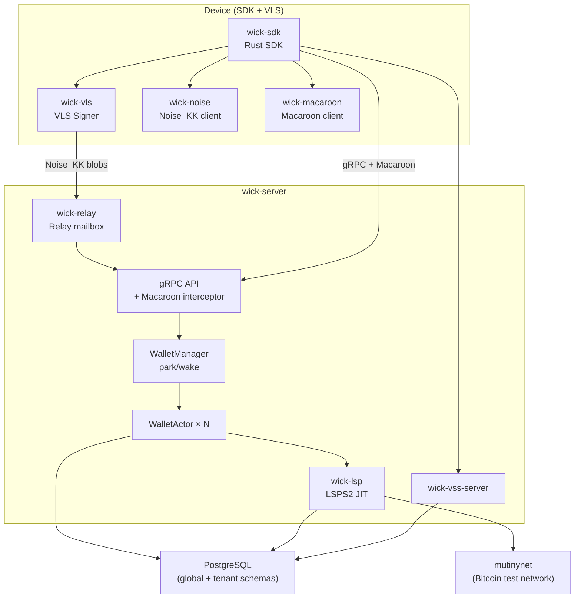

# Phase: PoC — Multi-tenant JIT on Mutinynet

**Status.** In progress
**Started.** ~March 2026
**Target completion.** June 2026 (estimated)

## Purpose

Prove the technical thesis end-to-end on a live test network:

1. A multi-tenant ldk-server can host multiple wallets in the same process with complete isolation.
2. LSPS2 JIT channels work — a wallet with zero balance receives a payment through a freshly opened JIT channel, fee deducted on delivery.
3. The VLS on-device signer enforces policy correctly — the server cannot move funds without device approval.
4. Park/wake lifecycle handles concurrent wakes under realistic load without OOM, deadlock, or HTLC loss.
5. Macaroon auth (revocation, spend-window, rotation) passes the automated test suite.

This is PoC, not Phase 0. It exists to validate technical and security assumptions. It does not need to be commercially deployable — it just needs to prove the thesis on mutinynet.

## Architecture Scope (this phase)

The diagram below shows what is in scope for the PoC. It is a strict subset of the full architecture overview in `docs/architecture-overview.md`.



**Out of scope for PoC:**
- Flutter FFI / WASM / NWC (SDK crates exist; not end-to-end validated)
- LSPS1 channel purchase
- LSPS5 webhooks
- Reorg reserve and griefing mitigation subsystems
- Reference Flutter wallet UI
- UTXO batching / CPFP / RBF subsystems
- WebLN browser extension

## In Scope

- [x] Noise_KK relay + VLS signer tunnel
- [x] Macaroon auth cascade (root → developer → user)
- [x] Macaroon revocation (nonce + LISTEN/NOTIFY)
- [x] Macaroon spend-window caveat enforcement
- [x] Server pubkey pinning (triple-source)
- [x] Multi-tenant WalletActor (actor model, mpsc, DashMap)
- [x] Park/wake lifecycle (activity poller, memory evictor, global semaphore, priority queue)
- [x] VSS server (encrypted versioned KV)
- [x] LSPS2 JIT channel open (LSP daemon, SCID dispatch, LiquidityManager)
- [ ] JIT payment round-trip on mutinynet — tenant-to-tenant — **in progress**
- [ ] Park/wake under concurrent mutinynet load — **in progress**
- [ ] CI integration test suite against mutinynet

## Done When

- [ ] `tenant_to_tenant_jit_payment_mutinynet` integration test passes reliably (≥5 consecutive runs)
- [x] Park/wake concurrent wake test: N concurrent `wake()` calls serialize correctly — exactly one factory call, all callers return Ok (`concurrent_wakes_serialize_via_cas` in manager.rs)
- [x] VLS policy test: policy rejection (status != 0x00) propagates as error, never treated as signature body (`policy_rejection_propagates_as_error_not_signature` in connection.rs)
- [x] Macaroon spend-window test: double-spend blocked (`second_spend_exceeding_limit_rejected` in spend_window_double_spend.rs)
- [x] Docker Compose for mutinynet: `deploy/docker/docker-compose.mutinynet.yml` + `Dockerfile`
- [ ] `tenant_to_tenant_jit_payment_mutinynet` passes reliably on the compose stack (≥5 consecutive runs)
- [ ] No `unwrap()` panics or deadlocks observed in 30-minute soak on the compose stack

## Known limitation — long-offline boot sync (root cause of the JIT hang)

**Symptom.** `tenant_to_tenant_jit_payment_mutinynet` appeared to "hang for 30 minutes" at `operator.register_lsp()` with no error.

**Root cause.** When a node (LSP or tenant) boots or wakes, it restores its LDK `ChannelManager` and channel monitors from Postgres, then calls `init::synchronize_listeners` (`wick-lightning/src/builder.rs`) to catch the persisted `best_block` up to the current chain tip. That catch-up is **linear in the number of blocks elapsed since the state was last persisted**, fetched batch-by-batch from Esplora. State left idle for days (mutinynet mines every ~30s ⇒ ~2,880 blocks/day) forces a walk of tens of thousands of blocks through a rate-limited public Esplora — tens of minutes. Because `register_lsp()` and the wake path had no client-visible deadline, this surfaced as a silent hang rather than an error.

Confirmed empirically (2026-05-30): a JIT channel from the 2026-05-22 runs left a monitor with `best_block` at block 3,121,137; the tip was 3,141,901 — a 20,764-block catch-up on every boot. The LSP tenant, Alice, and Bob all carried stale state derived deterministically from their constant mnemonics, so every run reproduced the same hang.

**Mitigations applied.**
- `OperatorClient::register_lsp()` now wraps the RPC in a 60s timeout (`REGISTER_LSP_TIMEOUT`) and returns `Error::Timeout` with a pointer to this section — a stuck boot is now an actionable error, not a hang.
- The server's `[park_wake].wake_deadline_secs` (90s) already bounds tenant wakes; a stale tenant fails its wake with `DeadlineExceeded` instead of hanging.

**Operational note.** This is primarily a stale-dev-state problem, not a production one: in normal park/wake, a tenant is offline for minutes, so the catch-up is a handful of blocks. Don't leave mutinynet test state idle for days. To recover a poisoned tenant, purge its `//manager` + `monitors//*` rows (and `channels` table) from its `tenant_<id>` schema so it boots fresh at the current tip. A durable fix (esplora script-based sync, or fast-forwarding `best_block` past a staleness threshold) is deferred to Phase 1 — see Done-When below.

## JIT step-5 stall — FIXED & verified (2026-05-30)

Root cause was **not** only the LSP handler: a thread dump of the wedged server
showed the whole tokio runtime dead (metrics endpoint + timers stopped) with the
process-events loop stuck in `PgKvStore::block_on → block_in_place → mpsc::recv`.
`PgKvStore::block_on` spawned its sqlx future on the **main** runtime then blocked
a main worker on `rx.recv()`; under the channel-open persistence burst (manager +
every monitor + EventQueue persisted at once) enough main workers parked in
`rx.recv()` that none were left to poll the spawned futures → permanent wedge.

Two fixes landed:
1. `wick-lightning/src/persistence/mod.rs` — drive PgKvStore sqlx futures on a
   **dedicated runtime** (`kv_runtime`) whose workers never `block_in_place`, so
   they always poll Postgres IO to completion. (commit on main)
2. `wick-lsp/src/handler.rs` — `forward_channel_ready` now skips non-JIT channels
   (a tenant's normal channel ChannelReady was being fed into the LSPS2 handler,
   erroring + blocking the LSP event loop).

**Verified live on the fresh-open path:** runtime stays alive through the burst
(metrics responsive), and step 5 `lsps2_get_info` returns in ~0.1s instead of
hanging forever. This was the user-reported "30-min stall" class, now resolved.

The `block_vls!` macro still uses the same `block_in_place(block_on)` shape, but
with PgKvStore no longer wedging the runtime it completes normally; left as-is
unless a future burst shows it wedging.

## Open bug — step-6 VLS "unbalanced payments" policy failure (NEW, next)

With the wedge gone, the JIT payment now reaches the actual commitment signing and
hits a VLS **policy** rejection on Alice's (payer) channel:

```
wick_vls: sign_counterparty_commitment failed ctx=Alice
  policy failure: validate_payments: unbalanced payments on channel … [<Bob's invoice hash>]
```

The SDK signer uses VLS's default `SimpleValidatorFactory` (wick-sdk/src/signer.rs).
For a holder *originating* a payment, VLS's `validate_payments` needs the outgoing
payment/invoice relayed to the device so the offered HTLC balances; otherwise it
sees an unexplained outgoing HTLC and rejects. This is a distinct, deeper
VLS-integration gap (payment-state sync to the device signer) — separate from the
stall and the SetupChannel-reattach fixes. It is the next blocker to close the PoC.

## JIT step-5 stall — historical detail (superseded by the FIXED section above)

With the stale-state hang resolved (above), a run on the **fresh-open path** (Alice opens her channel in-process, ~210s) progressed through register_lsp, connect_peer, and Alice's channel open, then **stalled indefinitely at step 5 — `bob.lsps2_get_info()`** with no output and no error.

**Mechanism (root-caused).** The server gRPC handlers `lsps2_get_info` / `get_jit_invoice` (`wick-server/src/grpc.rs`) `dispatch` the command to the tenant's actor and then `rx.await` the actor's response **with no timeout**. The actor (`node/actor.rs::run`) processes commands strictly serially: `handle(cmd).await` must finish before the next command. If an earlier `handle(cmd)` blocks on an `.await` that never completes (a stalled JIT/peer-lifecycle or signer round-trip during the slow channel-open window), the actor is wedged and `Lsps2GetInfo` queues behind it forever — so `rx.await` never returns. (Both `dispatch`'s wake (90s) and the actor's own `node.lsps2_get_info` (15s) are bounded; the unbounded link was the handler's `rx.await`.)

**Symptom fixed (commit pending).** `lsps2_get_info` and `get_jit_invoice` now wrap `rx.await` in `JIT_RPC_TIMEOUT` (30s) and return `DeadlineExceeded` instead of hanging — the client gets an actionable, retryable error rather than an indefinite stall. This is the same robustness pattern as `register_lsp`'s `REGISTER_LSP_TIMEOUT`.

**Root cause still open.** *Why* the actor wedges on the fresh-open path (and not on the reuse path, where Bob never idles long) is a JIT/wake/peer-lifecycle timing bug that needs a clean live reproduction with thread-level inspection. Reproduction is hampered by mutinynet cross-run state (each iteration ≈ 5 min). Reusing the `tenant_<id>` schemas across separate SDK processes also surfaces a **second, distinct bug** (below).

**Noisy-but-benign.** `wick_lsp: lsps2 channel_ready forward failed — No counterparty state for: 031ebe4d…` is **Alice** (tenant 14e6c970), whose *normal* (non-JIT) channel ChannelReady is passed into the LSPS2 handler. `forward_channel_ready` in `wick-lsp/src/handler.rs` should skip non-JIT channels rather than log an error.

## Open bug — step-6 VLS "channel not ready" on the reuse path

On the **reuse path** (Alice reuses a channel opened in a *prior* test process), step 5 passes but step 6 (the JIT payment) fails:

```
ERROR wick_vls: sign_counterparty_commitment failed ctx=14e6c970 (Alice)
  e=VLS signer error: channel not ready: 0279be66…(secp256k1 G sentinel)… dbid=16
```

The sentinel pubkey (compressed secp256k1 generator G) is the placeholder a VLS channel carries **before `SetupChannel` promotes it** with the real counterparty. So Alice's reused channel was never re-promoted in her *fresh* signer: VLS per-channel state (the `signer_channel_meta` / `SetupChannel` replay, commit 58bf5fe) does not survive across separate SDK processes. Signing the HTLC commitment then fails and the payment can't progress, so the JIT settlement times out at 240s.

A fully **fresh-open** run would set up the channel in-process and avoid this — but that path hits the step-5 actor wedge above. Closing the PoC needs one of: (a) fix the step-5 wedge so a fully-fresh run completes end-to-end, or (b) make VLS channel state reattach across process restarts so the reuse path works.

## LSP lifecycle stability under load — FIXED & verified (2026-05-30)

Three parallel agents root-caused the regtest-burst JIT instability as a single
cascade, and the fixes landed + verified (3 consecutive regtest `jit_flow` runs,
**zero cascade errors** each):

- **Trigger:** under a channel-open persistence burst, the `kv_runtime` funnels
  all KV connection returns (each paying a `RESET ALL` via the pool's
  `after_release` hook) through 4 workers — connection *return-rate* starves the
  pool (why 16→64 didn't help). Ruled out: no DB transaction is held across a
  VLS signer round-trip (VLS is decoupled from the pool).
- **Amplifier:** LDK's `process_events_async` returns `Err` on a persist failure;
  wick logged it and let the task DIE with no restart, against LDK's
  restart-after-error contract. For the **singleton LSP node** (no park/wake
  rebuild) this is fatal — it stops persisting, dispatching LDK events, and
  pumping peer I/O.
- **Symptom:** the BOLT8/`Init` handshake runs on net-tokio main-runtime tasks;
  a dead/starved LSP loop means its `Init` never sends → never appears in
  `list_peers` → "timeout waiting for handshake", RouteNotFound, get_jit_invoice
  stalls.

**Fixes (committed):**
- `builder.rs spawn_process_events`: supervised restart loop (re-enter with
  cloned Arc handles + capped backoff on `Err`, exit on graceful `Ok`/`stop_tx`).
- `persistence/mod.rs write_async`: retry transient sqlx errors (PoolTimedOut /
  PoolClosed / Io) 4× with backoff before surfacing.
- `db/pool.rs`: `acquire_timeout` 30s→10s (fail fast so retry/restart recover).

**Deferred (trigger-side perf, not stability):** a dedicated KV `PgPool` (no
`RESET ALL` hook) so KV traffic stops contending with tenant traffic; route the
remaining `event.rs` `block_on` through `kv_runtime`.

**Remaining functional blocker (separate from stability):** deterministic
`RouteNotFound` when the payer routes through the JIT intercept SCID on regtest
(the cascade is gone, so this is now a clean routing-correctness issue to chase
next). Plus an occasional regtest setup flake at `bitcoind send_to_address`.

## JIT settlement: VLS commitment-counter lag (open, precisely diagnosed 2026-05-31)

The Bob→Alice JIT payment now runs end-to-end through routing, the LSP HTLC
intercept, the JIT channel open to Alice, the operator funding loop signing +
broadcasting the JIT funding tx, and `channel_ready` on the JIT channel. It
fails at the final HTLC commitment dance because of a **persistent 1-commitment
lag in the VLS device's `next_holder_commit_num`**.

**Mechanism (confirmed by a per-call sequence trace + LDK/vls-core reads):**
- The device advances `next_holder_commit_num` only on `RevokeCommitmentTx`
  (`release_commitment_secret`), and `get_per_commitment_point(N)` is rejected
  when `N > next + 1` (vls-core channel.rs:513; the `+1` is the author's
  allowance for LDK fetching ONE point ahead before validate).
- LDK 0.2 fetches the point **two** ahead on the signer-unblock / RAA resend
  path: trace shows `get_per_commitment_point(3)` while `next=1` (gap 2 → fail),
  then `(4)` while `next=2`, etc. — a steady 1-commitment lag on top of the
  expected +1.
- Fixes applied that move it forward but don't fully resolve it:
  - `validate_holder_commitment` now forwards `ValidateCommitmentTx2` for
    post-funding commitments (was a stub) — commit 870b3fe.
  - `release_commitment_secret` now fires the signer-unblock callback after a
    successful `RevokeCommitmentTx`, so LDK retries the parked
    `get_per_commitment_point` once the counter advances. This makes the flow
    *progress* (commits 1→2→3→4) but each step still fails once then retries,
    and the cumulative instability makes LDK abandon the HTLC
    ("Payment failed at the first hop … channel peer … is broken",
    `TemporaryNodeFailure`).
  - `accept_intercept_htlcs = true` (builder) — fixes the separate
    `UnknownNextPeer`; the LSP now intercepts and opens the JIT channel.

**The real fix (next session):** eliminate the lag rather than retry around it.
Candidate directions, in order:
1. Check whether vls-protocol-signer's `GetPerCommitmentPoint2` handler uses the
   `get_per_commitment_point_unchecked` path at protocol **v6**
   (`PROTOCOL_VERSION_NO_SECRET`) — if v6 lifts the ceiling (the secret is
   decoupled), negotiating v6 *and confirming it actually lands* (the earlier v6
   test may not have negotiated) is the clean fix. wick already uses
   `GetPerCommitmentPoint2` + reads only the point.
2. If the ceiling holds at v6, study a reference LDK+VLS integration (lnrod) for
   how it keeps `next_holder_commit_num` in lockstep with LDK 0.2's eager
   point-fetch — likely a specific validate/revoke ordering wick is missing.
This is fund-securing signer code; do it carefully with the sequence trace
(re-add the `wick_vls::seq` traces from the 870b3fe-era diff to observe ordering).

## End-goal payment (Alice↔Bob) — status (2026-05-30)

Regtest `jit_flow` now gets the payment **almost** all the way: stability (no
wedge), routing (no RouteNotFound), Bob's channel + the JIT channel to Alice
open with full VLS signing. The single remaining blocker is at HTLC settlement:

**VLS commitment-number desync (`get_per_commitment_point: commitment_number 3
invalid when next_holder_commit_num is 1`).** Precise diagnosis (2 agents +
a sequence trace on Bob's channel, dbid=1):

```
get_per_commitment_point 0,1            validate_holder_commitment 0 (initial, forwards)
get_per_commitment_point 2              validate_holder_commitment 1 (forwards ValidateCommitmentTx2)
get_per_commitment_point 3  -> FAILS    release_commitment_secret 0  (revoke, AFTER the failed point)
```

The device's `next_holder_commit_num` only advances on `RevokeCommitmentTx`
(`release_commitment_secret`), and that requires a prior `ValidateCommitmentTx2`
to stage `next_holder_commit_info`. LDK 0.2 fetches `get_per_commitment_point(N+1)`
**eagerly** (point 3) *before* the revoke that would advance the counter — and
on the signer-unblock **resend path** (`get_last_revoke_and_ack`) it skips
`validate_holder_commitment` entirely. So the device counter is stranded at 1.

Confirmed NOT version-related: the `> next+1` ceiling holds at both v5 and v6
(GetPerCommitmentPoint2). Applied so far: `validate_holder_commitment` now
forwards `ValidateCommitmentTx2` for post-funding commitments (was a blanket
`Ok(())` stub) — necessary but not sufficient.

**The fix (next session — fund-securing signer code, do carefully):** drive
`ValidateCommitmentTx2(n)` from inside `release_commitment_secret` (which IS on
the resend path) before its `RevokeCommitmentTx(n-1)`, replaying the holder
commitment cached from `validate_holder_commitment`. Reference a working
LDK+VLS integration (lnrod) for the exact v5 validate→revoke pairing. Files:
`crates/wick-vls/src/session.rs` (release_commitment_secret ~1371,
validate_holder_commitment ~1387), `rpc.rs` (rpc_validate_holder_commitment,
rpc_release_commitment_secret).

## Active Work (as of May 2026)

Based on recent commits:
- Fixing EventQueue deadlock via PgKvStore future decoupling (`f53d3de`)
- JIT payment test fitting under `htlc_in_flight_percent` limit (`31fb1d1`)
- Multi-tenant LSP lifecycle stabilisation on mutinynet (`30befb7`)
- Diagnostic tracing for tenant-to-tenant JIT path (`33c4c60`)
- **2026-05-30:** root-caused + fixed the 30-min register_lsp hang (stale `best_block` boot-sync crawl); added `REGISTER_LSP_TIMEOUT`. Next: JIT step-5 stall.

## Phase 1 (after PoC)

Developer SDK beta — publicly accessible hosted instance at wick.cloud, Rust SDK on crates.io, developer macaroon issuance, basic dashboard. Gate on PoC "Done When" checklist above.
